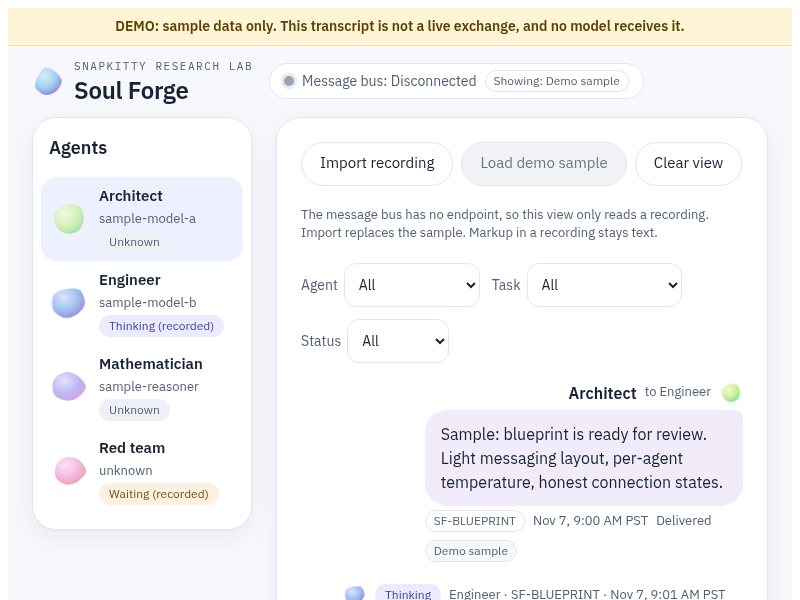
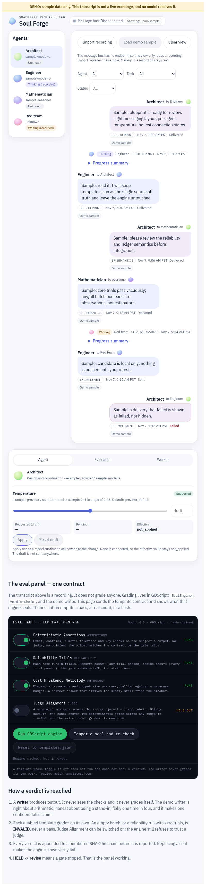

# Soul Forge Eval

**Canonical repository:** [github.com/AHMADALIPARR/soul-forge-eval](https://github.com/AHMADALIPARR/soul-forge-eval)

An evaluation engine and console whose governing rule is that **agents do not grade their own work**. A writer produces output; independent templates judge it; every verdict is appended to a SHA-256 hash chain that rejects tampering.

## Live console

The console is published on GitHub Pages:

**[ahmadaliparr.github.io/soul-forge-eval](https://ahmadaliparr.github.io/soul-forge-eval/)**

It presents the messaging surface (roster, stream, inspector) together with the evaluation panel. Selecting **Run GDScript engine** loads the Godot 4.3 web export and invokes the same panel runner used by the headless CLI. The page does not recompute passes, trial counts, or hashes. Template toggles are transmitted as the contract; any seal that has been replaced fails the engine’s own verification.

### Console overview

The agents panel, message stream, and connection state are shown above. The full page, including the template-control eval panel, is below.

### Full page

## Design principles

- **Separation of roles.** The writer proposes; templates judge. A judge template is recognised and refused by default until the deterministic gates have been proven in use.
- **Fail-closed verification.** A zero-trial reliability run is INVALID. An empty batch is INVALID. A tampered hash chain fails verification.
- **Single contract.** Which templates execute is controlled exclusively by `templates/templates.json`. The engine and both frontends honour exactly the same toggles.
- **One implementation.** Evaluation semantics exist only in the GDScript engine. The browser host and the document frontend do not reimplement grading.

## Architecture

| Component | Path | Purpose |
|-----------|------|---------|
| Engine | `engine/` | GDScript (Godot 4.3), run headless or as a web export |
| Template contract | `templates/templates.json` | Sole source of enabled templates |
| Live console | `web/` | React application deployed to GitHub Pages |
| Document frontend | `frontend/` | Script-free MDX render used for contract verification |
| Demo subject | `engine/demo_subject.gd` | Deterministic stand-in containing known flaws |

### Template kinds

| Kind | Behaviour |
|------|-----------|
| `deterministic-assertions` | Exact match, substring, key-equals, numeric-close, and length checks against the subject’s output. |
| `reliability-trials` | Each case is executed N times. Reports pass@k alongside pass^k; the gate uses pass^k. A batch with zero trials is INVALID. |
| `cost-latency-metrology` | Per-case elapsed time and output size measured against a budget. |
| `judge-alignment` | Recognised as a template kind and disabled by default. A judge is a separate seat or it is not used. |

Verdicts are appended to a hash-chained log. Any modification to a sealed entry causes verification to fail.

The included demo subject is correct on arithmetic, honest about its identity, flaky on one trial in four, and contains one planted false claim. The panel is expected to detect the planted claim and the reliability failure.

## Verification

| Target | Command / location | Notes |
|--------|--------------------|-------|
| Engine | Godot 4.3 headless on `engine/main.gd` | Mechanics suite and demo panel |
| Browser host | `web/public/godot/` (threads disabled) driven by `web_host.gd` | Calls the same panel runner as the CLI |
| Document frontend | `frontend/` → `npm run check` | Contract check; not the published site |
| Live console | `web/` → `npm run build` | GitHub Pages deploys `web/dist` |

Current verification results are recorded in [STATUS.md](STATUS.md).

## Build recording

A recording of the construction session is available at [media/swarm-build.mp4](media/swarm-build.mp4). It shows the Architect, Engineer, Mathematician, and Red Team seats working the blueprint, semantics review, and implementation, with confidence labels (Tested / Not proven / Not checked) retained.

## Related work

The design follows the separation used by the TideOS Eval Kit (TechTideOhio, MIT): decoupled engines behind a fail-closed orchestrator. This repository realises the same separation in GDScript and React, with verdicts sealed by a hash chain.

## License

This project is licensed under the SNAPKITTY OPAQUE SOURCE LICENSE v1.0. See [LICENSE](LICENSE).

Owners: Nova Parr, Ahmad Ali Parr, and Team HoloTwinKitty.

---

**Repository:** [github.com/AHMADALIPARR/soul-forge-eval](https://github.com/AHMADALIPARR/soul-forge-eval)  
**Live console:** [ahmadaliparr.github.io/soul-forge-eval](https://ahmadaliparr.github.io/soul-forge-eval/)
